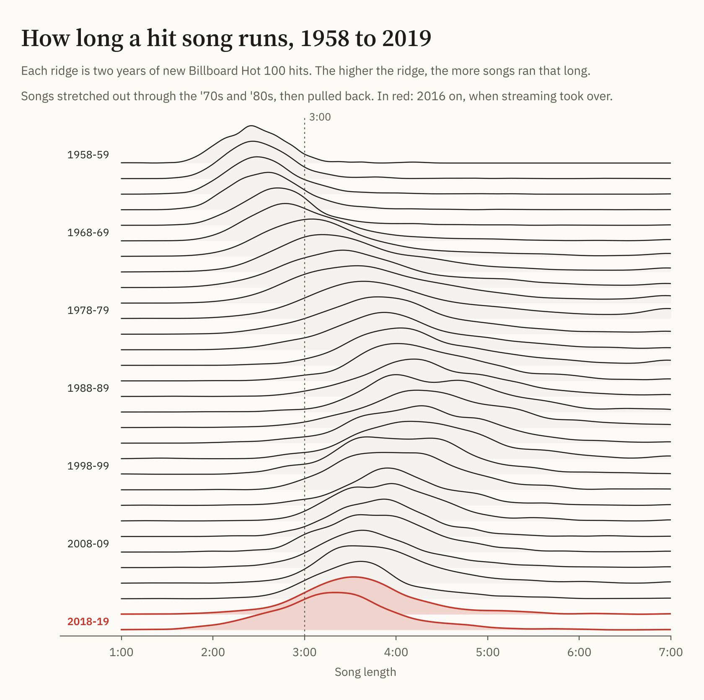
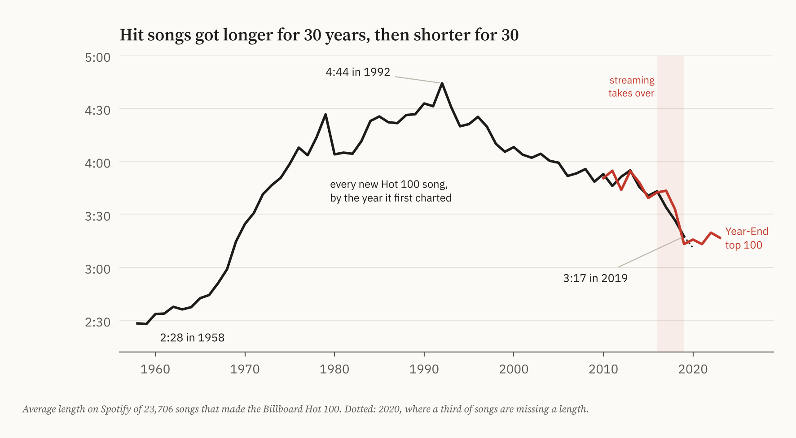
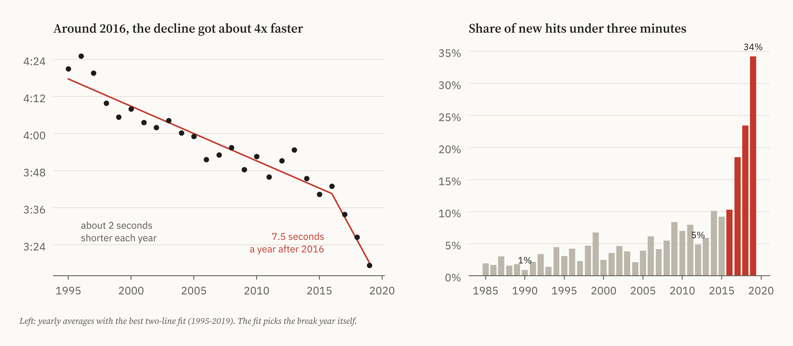
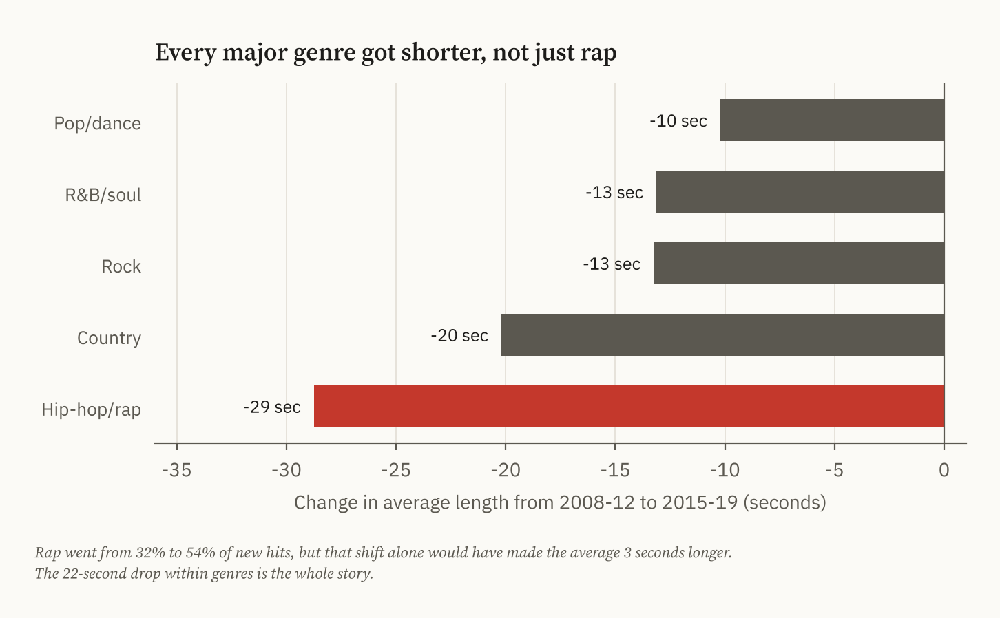
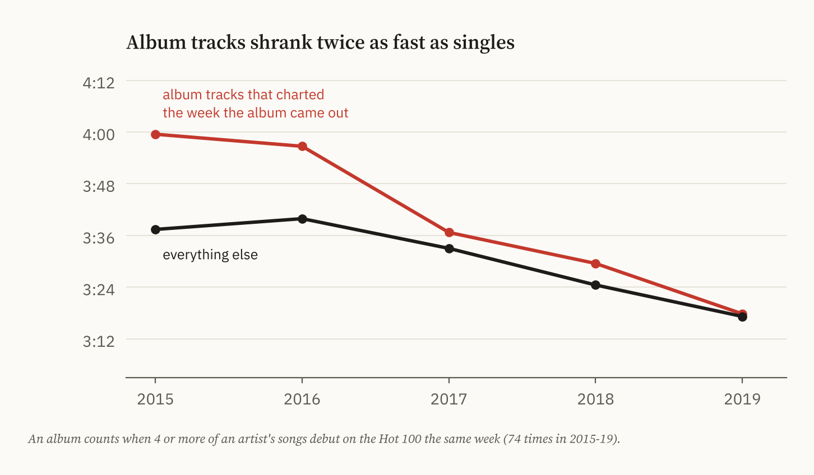
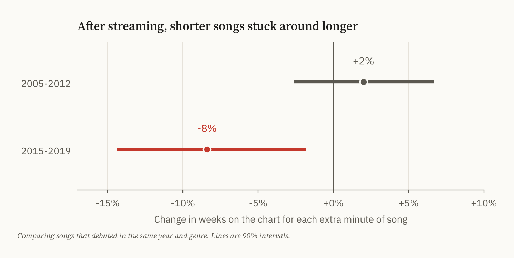
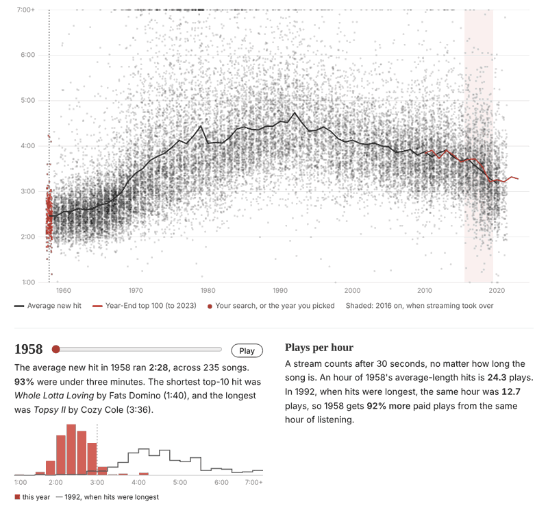

# Did Streaming Make Songs Shorter?

Jordan Salter · M.S. Statistics, USC · October 2026



Spotify pays artists per stream, and a stream counts after 30 seconds whether the song is two minutes long or six. That means a shorter song can earn more from the same hour of listening. I'd seen the claim that songs are getting shorter because of this. I wanted to check whether the data actually backs it up, or whether it's something that was already happening.

I used every song that made the Billboard Hot 100 between 1958 and 2019 (23,706 of them have a length on Spotify), plus the Year-End Hot 100 through 2023.



The first thing that surprised me is that songs started getting shorter in the early '90s, more than 20 years before streaming. The average new hit peaked at 4:44 in 1992 and lost a couple of seconds a year after that. So streaming didn't start the trend. The question is whether it changed it.

It did. I fit a line with one bend in it to the yearly averages from 1995 to 2019 and let the fit choose where the bend goes. It put it at **2016**, the year streaming became the music industry's biggest source of revenue in the US. Before 2016, songs got about 2 seconds shorter each year. After, it was 7.5 seconds a year, roughly four times as fast. Starting the fit at different years (1993, 1998, 2000, 2002) gives 2016 every time.



The share of songs under three minutes might be the clearest way to see it. In 1990 it was 1%. In 2012 it was still only 5%. By 2019 it was a third of all new hits. From 2014 to 2019 the average hit lost 28 seconds, which ties with 2013-2018 for the biggest five-year drop in the chart's history.

## It's not just rap

My first guess was that this was about rap taking over the chart. Rap went from 32% of new hits in 2008-12 to 54% in 2015-19, so if rap songs were short, that alone could explain it.

It turns out rap songs were actually longer than average before 2015, so the shift toward rap would have made the average a bit *longer* (by about 3 seconds). The whole drop came from songs getting shorter within each genre. Rap shrank the most, but country, rock, R&B and pop all got shorter too.



It also wasn't just new artists replacing old ones. The 147 artists who had hits in both 2008-12 and 2015-19 cut their own songs by 13 seconds on average. That's not unheard of (artists' songs also got about 11 seconds shorter in the late '90s), but it shows working artists were changing their music too.

## Album tracks shrank the most

This was the part I found most interesting. In the streaming era, when a big artist drops an album, a lot of its tracks can chart in the same week. In one week in 2018, Drake's *Scorpion* put 17 new songs on the Hot 100. These tracks weren't picked as singles or edited for radio, so they're a good look at what artists were actually putting on their albums.

In 2015 and 2016, those album tracks averaged 3:58, about 19 seconds longer than everything else on the chart. By 2019 the gap was gone, with both at about 3:18. Album tracks lost 40 seconds in four years, about twice as much as everything else. That fits the streaming math: if every track on an album earns per play, shorter tracks mean more plays.



## Shorter songs lasted longer on the chart

If streaming rewards short songs, they should start doing better on a chart that counts streams. I compared songs that came out in the same year and genre. From 2005 to 2012, length didn't really matter for how long a song stayed on the Hot 100. From 2015 to 2019, each extra minute meant about 8% fewer weeks on the chart. Length had no effect on whether a song reached the top 10, though. Short songs weren't bigger hits. They just hung around longer, which is what you'd expect if people replay them more.



To put a number on the incentive: an hour of average-length 1992 hits is about 12.7 plays. An hour of average 2019 hits is 18.2 plays. That's 44% more paid streams from the same hour of listening.

## After 2019

My weekly data stops having song lengths after 2019, but the Year-End Hot 100 goes through 2023. The top 100 songs averaged 3:50 in 2010-14 and 3:16 in 2019-23. But from 2019 to 2023, the average barely moved. It looks like most of the drop happened between 2016 and 2019 and then leveled off at around 3:15.

## The explorer

I also made an [interactive explorer](https://jlsalter.github.io/hit-length/) with all 24,000+ songs. You can search for any artist or song, filter by genre, or press play and watch the years go by. For each year it shows the average length, the shortest and longest top-10 hits, how that year's lengths compare with 1992, and how many plays an hour of that year's hits would get.

[](https://jlsalter.github.io/hit-length/)

## What this can't tell me

This shows that the timing lines up with streaming, and that the change shows up in places you'd expect if streaming was the cause (within genres, within artists, on album tracks, and in what the chart rewarded). It doesn't prove streaming caused it. Other things changed around the same time, like playlists and later TikTok.

The weekly data also stops at 2019, so the post-2016 speed-up is based on only a few years. Song lengths are the Spotify version of each song, which can be different from the radio edit, and about 1 in 6 songs before 2020 is missing a length. Genres come from Spotify's tags for each artist, not each song.

More detail on every step, including all the bootstrap intervals, is in [METHODS.md](METHODS.md).

## Data and code

- Weekly Hot 100 charts (Aug 1958 - May 2021) and Spotify song lengths: [TidyTuesday](https://github.com/rfordatascience/tidytuesday/tree/master/data/2021/2021-09-14)
- Year-End Hot 100 with Spotify lengths, 2010-2023: [spotify-aa-dataset](https://github.com/AayushG159/spotify-aa-dataset)
- Billboard started counting on-demand streams in the Hot 100 in 2012 and YouTube plays in 2013. Streaming passed downloads and CDs combined in US revenue in 2016.

I loaded everything into SQLite and built the song and year tables in SQL ([`sql/`](sql/)). The analysis is in Python ([`src/analysis.py`](src/analysis.py)), and [`run_all.sh`](run_all.sh) rebuilds everything from the raw files in under a minute.

```
pip install -r requirements.txt
./run_all.sh
```
